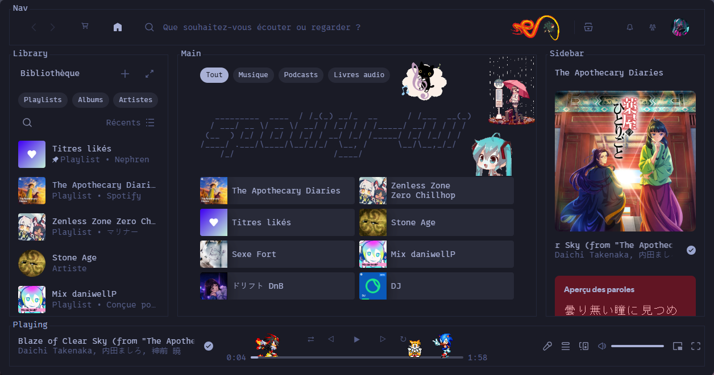
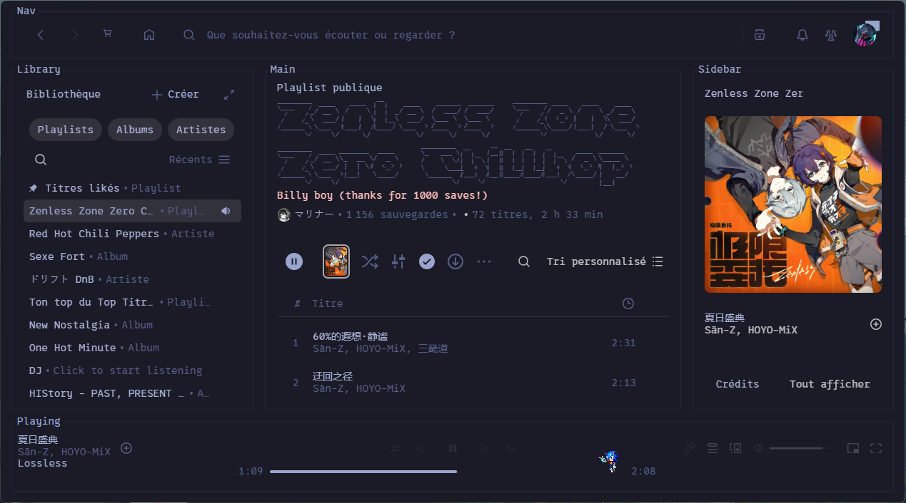

# Spicetify-tui

🇫🇷 [Version française](README_FRENCH.md)

A Spicetify theme inspired by [spotify-tui](https://github.com/Rigellute/spotify-tui), styled after a terminal interface: panel border labels ("Nav", "Library", "Main", "Sidebar", "Playing"), Nerd Font monospace typography, an ASCII art banner on the home page, ASCII page titles, and text-glyph playback controls instead of SVG icons. The window frame itself is reworked too — thinner borders and no minimize/maximize/close buttons, for a clean, borderless look that fits tiling window managers like [komorebi](https://github.com/LGUG2Z/komorebi).

Originally based on the community [`text`](https://github.com/spicetify/spicetify-themes/tree/main/text) theme from the official `spicetify-themes` repo, heavily reworked since (progress bar, volume bar, layout, window frame, and compatibility fixes for recent Spotify updates).

Besides the theme, the repo ships a few small **Spicetify extensions**: one that cleans up backgrounds and cover art, a workaround for the Marketplace tab bar, and **draggable animated GIF characters** (Sonic, Tails, Shadow, Miku, Tanjiro...) that you can move around, resize, or switch off.

> Developed and tested on Windows 11 with Spotify 1.3.4 and Spicetify 2.45.3 (October 2026). Spotify updates regularly rename its internal CSS classes and change its page structure, so if something looks off after an update, see [After a Spotify update](#after-a-spotify-update).

## Table of contents

- [Preview](#preview)
- [Requirements](#requirements)
- [What's in this repo](#whats-in-this-repo)
- [Installation](#installation)
- [The extensions](#the-extensions)
  - [`noControls.js`](#nocontrolsjs)
  - [`flatBackgrounds.js`](#flatbackgroundsjs)
  - [`marketplaceTabs.js`](#marketplacetabsjs)
  - [`draggablePets.js`](#draggablepetsjs)
- [The animated characters](#the-animated-characters)
  - [Using them](#using-them)
  - [Where they appear](#where-they-appear)
  - [Turning them off or removing them](#turning-them-off-or-removing-them)
- [Customizing](#customizing)
- [About the window frame](#about-the-window-frame)
  - [Getting the native buttons back](#getting-the-native-buttons-back)
- [After a Spotify update](#after-a-spotify-update)
- [Changing the palette or theme](#changing-the-palette-or-theme)
  - [Switch to another palette](#switch-to-another-palette)
  - [Create your own palette](#create-your-own-palette)
  - [Use a different theme (not TUI)](#use-a-different-theme-not-tui)
- [Troubleshooting](#troubleshooting)
- [Credits and copyright](#credits-and-copyright)
- [License](#license)

## Preview




## Requirements

- [Spicetify](https://spicetify.app/) installed and working (2.45.3 tested)
- Spotify desktop installed with the official installer — Spicetify does not support the Microsoft Store version
- The **[0xProto Nerd Font Mono](https://github.com/ryanoasis/nerd-fonts/releases/latest/download/0xProto.zip)** font installed on your system — required for the ASCII banner alignment and the control glyphs
- An internet connection when Spotify starts: `user.css` loads the `asciid` font (used for the ASCII page titles) from `fonts.cdnfonts.com`, and optional Google Fonts monospace alternatives

## What's in this repo

| File | What it is | Where it goes |
|---|---|---|
| `user.css` | The theme's styles | `Themes/TUI/` |
| `color.ini` | The color palettes | `Themes/TUI/` |
| `noControls.js` | Extension that removes the native window controls ([details](#nocontrolsjs)) | `Extensions/` |
| `flatBackgrounds.js` | Extension that flattens backgrounds and hides header cover art ([details](#flatbackgroundsjs)) | `Extensions/` |
| `marketplaceTabs.js` | Extension that brings the Marketplace tab bar back ([details](#marketplacetabsjs)) | `Extensions/` |
| `draggablePets.js` | Extension that adds the draggable animated characters ([details](#draggablepetsjs)) | `Extensions/` |

Both folders live in your Spicetify config directory: `%appdata%\spicetify\` on Windows, `~/.config/spicetify/` on Linux/macOS. `spicetify -c` prints the path of the `config-xpui.ini` file, which sits in that same directory.

**Which extensions do you need?**

| Extension | Needed? |
|---|---|
| `noControls.js` | Recommended — the theme is designed for a window without native buttons |
| `flatBackgrounds.js` | Recommended — without it, header cover art can stay visible and colored gradients can come back on some pages |
| `marketplaceTabs.js` | Only if you use the Marketplace — it works around an upstream bug and can be removed once that is fixed |
| `draggablePets.js` | Optional — purely decorative (and the heaviest file, about 670 KB, because the GIFs are embedded in it) |

## Installation

1. Install the **0xProto Nerd Font Mono** font (link above) if you haven't already.
2. Download `user.css`, `color.ini` and the extensions you want (`noControls.js`, `flatBackgrounds.js`, `marketplaceTabs.js`, `draggablePets.js`) from this repo.
3. Copy them into your Spicetify config directory. From the folder containing the downloaded files, in PowerShell:
   ```powershell
   $cfg = spicetify -c | Split-Path
   New-Item -ItemType Directory -Force "$cfg\Themes\TUI", "$cfg\Extensions" | Out-Null
   Copy-Item .\user.css, .\color.ini "$cfg\Themes\TUI\"
   Copy-Item .\noControls.js, .\flatBackgrounds.js, .\marketplaceTabs.js, .\draggablePets.js "$cfg\Extensions\"
   ```
   Or by hand: `user.css` and `color.ini` go in a new `Themes/TUI/` folder, the `.js` files go in `Extensions/`. Leave out the extensions you don't want.
4. Enable the theme and the extensions:
   ```
   spicetify config current_theme TUI
   spicetify config color_scheme TokyoNight
   spicetify config inject_css 1 replace_colors 1 overwrite_assets 1
   spicetify config extensions noControls.js
   spicetify config extensions flatBackgrounds.js
   spicetify config extensions marketplaceTabs.js
   spicetify config extensions draggablePets.js
   ```
   Each `spicetify config extensions <file>` adds the extension to your list, it doesn't replace the extensions you already use. Skip the lines of the extensions you didn't copy.

   Want another palette than `TokyoNight`? See [Changing the palette or theme](#changing-the-palette-or-theme).
5. Apply:
   ```
   spicetify apply
   ```
   If Spicetify complains about a missing backup (first use, or right after reinstalling Spotify), run `spicetify backup apply` instead.
6. Check with `spicetify config` that `current_theme` is `TUI`, and with `spicetify config extensions` that the list contains the extensions you enabled.

> **Scoop users** — keep the files in the config directory above, not in `scoop\apps\spicetify-cli\<version>\Themes`: that folder is specific to one Spicetify version and isn't carried over when Scoop installs the next one. If Spicetify reports an extension as not found after an update, also copy it to `scoop\apps\spicetify-cli\<version>\Extensions` (this fixed it in testing with `noControls.js`).

## The extensions

The extensions are plain JavaScript files that Spicetify runs inside Spotify. They are short and commented (apart from the GIF data embedded in `draggablePets.js`), so you can read them before installing. To disable one, run `spicetify config extensions <file>-` (note the trailing `-`) and `spicetify apply`.

### `noControls.js`

The theme is designed for a window without native minimize/maximize/close buttons. `noControls.js` is the small extension that removes them (it comes from the Spicetify community; see [Credits](#credits-and-copyright)), and `user.css` handles the layout side: it sets `--global-nav-margin-top` to `0px` and collapses the space Spotify reserves for those buttons at the top right of the window (the rules commented "space reserved for the window buttons / controls" in `user.css`).

Because that space is gone, the native buttons may overlap the top-right icons if the extension isn't loaded. Either install the extension (steps 3 and 4 above) or follow [Getting the native buttons back](#getting-the-native-buttons-back).

### `flatBackgrounds.js`

Spotify paints its pages with color tints and gradients that depend on the album art, and it renames the CSS classes that carry them with every update. This extension does that work in a way that doesn't depend on class names:

- it removes tints and gradients from the main panel (`#main-view`): sticky bars and headers get the plain theme color, everything else becomes transparent;
- when `--display-header-image` is `none` (the default), it hides the large cover art at the top of playlist, album and artist pages, detecting the image by its size and position instead of by class names;
- it tags the artist name on artist pages so that `user.css` can style it with the ASCII title font.

It only looks at `#main-view`, reacts to page changes as they happen (so there is no flash), and leaves buttons, inputs, rows and menus alone.

### `marketplaceTabs.js`

Since Spotify 1.3.3, the Marketplace custom app no longer shows its tab bar (Extensions / Themes / Snippets / Apps), with or without a theme: it mounts the bar into an element that Spotify removed. This is an upstream bug, tracked in [spicetify/marketplace #1253](https://github.com/spicetify/marketplace/issues/1253) and [#1265](https://github.com/spicetify/marketplace/issues/1265). The extension recreates that empty element at the top of the main view so the tabs can render again.

You only need it if you use the Marketplace. Once the Marketplace is fixed, remove it: `spicetify config extensions marketplaceTabs.js-`, then `spicetify apply`. `user.css` also tidies the Marketplace grid (3 columns, smaller card text, a discreet "Add CSS" button).

### `draggablePets.js`

Adds the animated characters described [below](#the-animated-characters). The file is about 670 KB because the GIFs are embedded in it as base64; the logic itself is around 360 lines.

## The animated characters

`draggablePets.js` adds animated GIF characters to the interface. They are real elements floating above Spotify, so you can **drag them anywhere**, resize them, and hide them.

### Using them

- **Move**: click a character and drag it anywhere in the window. Its position is remembered (as a proportion of the window size).
- **Back to the default position**: double-click the character (only that character's position; its size is left as it is).
- **Settings panel**: right-click a character, or press **Ctrl+Alt+P** (the extension also tries to add an entry to Spicetify's profile menu, which depends on your Spotify version). The panel lets you:
  - show or hide each character with its checkbox;
  - resize them with the sliders ("Sprites" = Shadow, Tails and Sonic together; then one slider each for Cat, Miku, Tanjiro and Ambers), from 50% to 200%;
  - **Reset positions & sizes** to restore every default position and every default size (100%); hidden characters stay hidden;
  - **Hide / show all** at once.
- **From the console** (DevTools, see [After a Spotify update](#after-a-spotify-update)): `tuiPets.panel()` opens the panel, `tuiPets.toggle("cat")` hides or shows one character (ids: `shadow`, `tails`, `sonic`, `cat`, `miku`, `tanjiro`, `ambers`), `tuiPets.reset()` does the same as **Reset positions & sizes** (default positions and sizes), `tuiPets.setMargin(n)` changes how far Sonic and Tails sit from the right end of the progress bar (default `0`, negative values push them further right).

Settings are stored in Spotify's local storage under the key `tui-pets-v1`.

### Where they appear

| Character | Default position | Shown on |
|---|---|---|
| Shadow | Start of the progress bar, standing on it | every page |
| Tails, Sonic | Right end of the progress bar | every page |
| Tanjiro | Search bar, left of the vertical separator | every page |
| Cat | Home page, top of the main panel, to the right of the filter chips | home page only |
| Miku | Home page, sitting on the top edge of the top-right shortcut tile | home page only |
| Ambers | Home page, top-right corner of the Main frame | home page only |

Default positions are computed from elements of the page (progress bar, search bar, shortcut tiles...), so they follow window resizing. If a Spotify update moves those elements and a character lands in the wrong place, drag it where you want it, or adjust the formulas in the `defaultPos` function of `draggablePets.js`.

Keep in mind that the characters sit above the interface and **capture the mouse** while you hover them: if one covers a button you need, drag it away or hide it.

### Turning them off or removing them

- Temporarily: **Hide / show all** in the panel (or `tuiPets.toggle(...)` per character).
- Completely: `spicetify config extensions draggablePets.js-`, then `spicetify apply`. You can also delete the file from your `Extensions/` folder.

`user.css` no longer draws any character itself, so there is nothing else to remove.

## Customizing

The options at the top of `user.css` (`:root` block) can be changed freely, then run `spicetify apply`:

| Variable | Effect |
|---|---|
| `--font-family` | Main font (default `0xProto Nerd Font Mono`); other monospace fonts are listed in a comment |
| `--display-card-image` | `block` / `none`: cover art on cards |
| `--display-coverart-image` | `block` / `none`: cover art in the playback bar |
| `--display-header-image` | `block` / `none`: large cover art at the top of playlist/album/artist pages (default `none`, hidden by `flatBackgrounds.js`) |
| `--display-sidebar-image` | `block` / `none`: cover art in the right sidebar |
| `--display-tracklist-image` | `block` / `none`: thumbnails in track lists (default `none`) |
| `--display-spicetify-banner-ascii` | `block` / `none`: the ASCII banner on the home page |
| `--banner-ascii-height` | Space reserved for that banner: set it to `0px` if you hide the banner |
| `--tui-header-height` | Minimum height of playlist/album/artist page headers (near the end of the file) |
| `--border-radius`, `--border-width` | Shape and thickness of the panel borders |

Chip size (`zoom` on `[data-encore-id="chip"]`) and the Marketplace grid (`minmax(150px, 1fr)`) are set in the last blocks of the file.

## About the window frame

This theme removes the native minimize/maximize/close buttons and slims down the window borders, matching the borderless look tiling window managers usually go for. Keep in mind what that changes in practice:

- **Closing/minimizing the app** now depends entirely on your window manager's keybinds (or the system tray icon / taskbar) — there's no button left to click.
- If you're **not** running a tiling WM (komorebi, GlazeWM, i3, etc.), test this on a machine where you can still reach the app another way before committing to it daily — Alt+F4 still works, but it's easy to feel "stuck" the first time.

### Getting the native buttons back

You can keep the rest of the theme and restore the buttons:

1. Remove the extension from your config:
   ```
   spicetify config extensions noControls.js-
   ```
2. In `user.css`, raise `--global-nav-margin-top` (for example to `32px`) until the top bar sits below the native buttons.
3. Delete or comment out the three rules commented "space reserved for the window controls" / "space reserved for the window buttons" (search for `space reserved for the window` in `user.css`).
4. Run `spicetify apply`.

## After a Spotify update

Spotify updates can overwrite Spicetify's changes, rename the classes the theme relies on, or change the structure of the page. The current version of the theme leans on stable hooks (element ids, `data-testid`, `aria-label`, roles) and on the extensions, but a few rules still target generated class names.

1. **Re-apply Spicetify:** `spicetify backup apply`.
2. **If Spicetify says the Spotify version and the backup version are mismatched** and refuses to back up: reinstall Spotify with the official installer, launch it once, close it, then run `spicetify backup apply` (not `restore`, there is nothing left to restore).
3. **Scoop users:** update Spicetify with `scoop update spicetify-cli`. The built-in `spicetify update` can fail on a Scoop install.
4. **If a colored gradient or tint comes back** (top of the home page, top of a playlist page...), the rules that neutralize them need the new class names Spotify generated. They look like `[class*="dqwQh"]` and are grouped in the blocks commented "Spotify 1.3.x" near the end of `user.css`.
5. **If the ASCII banner disappears**, check the rule just below the "MAIN VIEW" comment: it relies on `[data-testid="home-page"]`.

To find new class names, enable DevTools: `spicetify config always_enable_devtools 1`, then `spicetify apply`, restart Spotify and press Ctrl+Shift+I (or right-click → Inspect element). Select the colored area, copy a few characters of its class name, and update the matching rule. Copy rather than retype: in the DevTools font, `I`/`l` and `0`/`O` look alike. Then run `spicetify apply` again.

Also worth checking after an update: whether the [Marketplace bug](#marketplacetabsjs) has been fixed upstream (then `marketplaceTabs.js` can go).

If something else breaks, open an issue with a screenshot and your Spotify and Spicetify versions (`spicetify -v`).

## Changing the palette or theme

All the colors live in `color.ini`, one palette per `[Section]`. The value you give to `color_scheme` must match a section name **exactly** — same capitalization, no spaces, no accents (`RosePine`, not `Rosé Pine`; `CatppuccinMocha`, not `Catppuccin`).

### Switch to another palette

1. Pick a name from the list below, or list them straight from your install:
   ```powershell
   Select-String -Path "$(spicetify -c | Split-Path)\Themes\TUI\color.ini" -Pattern '^\[(.+)\]' | ForEach-Object { $_.Matches[0].Groups[1].Value }
   ```
2. Set it and apply (example with Dracula):
   ```
   spicetify config color_scheme Dracula
   spicetify apply
   ```
3. Check with `spicetify config` that `current_theme` is `TUI`, `color_scheme` is the palette you chose, and that `inject_css` and `replace_colors` are both `1`.

Available palettes: `TokyoNight` (default in this guide), `TokyoNightStorm`, `CatppuccinMocha`, `CatppuccinMacchiato`, `CatppuccinLatte`, `Dracula`, `Gruvbox`, `Kanagawa`, `Nord`, `Rigel`, `RosePine`, `RosePineMoon`, `RosePineDawn`, `Solarized`, `EverforestDarkMedium`, `ForestGreen`, `Spotify`, `Spicetify`.

**Nothing changed after `spicetify apply`?**

- The name doesn't match a section of `color.ini` exactly (see the note above).
- `replace_colors` is `0`: run `spicetify config replace_colors 1 inject_css 1`, then `spicetify apply`.
- You edited `color.ini` in a downloaded copy of the repo instead of the one Spicetify reads: it must be in `%appdata%\spicetify\Themes\TUI\` (`spicetify -c | Split-Path` prints the config folder).
- Spotify didn't reload: close it completely (system tray included), reopen it, or run `spicetify apply` again.

### Create your own palette

Copy an existing block of `color.ini`, rename the `[Section]`, and change the values (hex colors, **without** the `#`):

```ini
[MyPalette]
accent             = ff79c6
accent-active      = ff79c6
accent-inactive    = 1e1e2e
banner             = ff79c6
border-active      = ff79c6
border-inactive    = 313244
header             = 585b70
highlight          = 585b70
main               = 1e1e2e
notification       = 89b4fa
notification-error = f38ba8
subtext            = a6adc8
text               = cdd6f4
```

Then `spicetify config color_scheme MyPalette` and `spicetify apply`. All 13 keys must be present. Roughly: `main` is the background, `text`/`subtext` the text colors, and `accent` the highlight color.

### Use a different theme (not TUI)

```
spicetify config current_theme <ThemeFolderName>
spicetify config color_scheme <a palette from that theme's color.ini>
spicetify config extensions noControls.js-
spicetify config extensions flatBackgrounds.js-
spicetify apply
```

The third line matters: `noControls.js` hides the native window buttons, and other themes don't make room for them — see [Getting the native buttons back](#getting-the-native-buttons-back). `flatBackgrounds.js` is written for this theme and would also flatten another theme's backgrounds, so remove it too. `draggablePets.js` and `marketplaceTabs.js` don't depend on the theme and can stay. To remove Spicetify's changes entirely, run `spicetify restore` (and `spicetify backup apply` to bring them back).

## Troubleshooting

- **No character shows up:** check that `spicetify config extensions` lists `draggablePets.js`, then run `spicetify apply` and restart Spotify. Cat, Miku and Ambers only appear on the home page. Press Ctrl+Alt+P to open the panel and check the boxes; **Hide / show all** may have hidden everything.
- **Characters appear twice:** you are mixing an older version of `user.css` (which drew some characters in CSS) with the current extension. Use the `user.css` of this repo.
- **A character is stuck in the wrong place:** double-click it, or use **Reset positions & sizes** in the panel.
- **A character covers a button:** drag it away; characters capture the mouse while you hover them.
- **Marketplace tabs are missing:** enable `marketplaceTabs.js` (see [above](#marketplacetabsjs)).
- **Header cover art or colored gradients are back on playlist pages:** `flatBackgrounds.js` is not enabled, or a Spotify update changed a class name (see [After a Spotify update](#after-a-spotify-update)).
- **The console shows warnings:** DevTools may list warnings about preloaded fonts, failed `sentry.io` requests (if you block telemetry) and repeated `Resolver not found` errors coming from `noControls.js` with recent Spotify versions. They don't affect the theme.

## Credits and copyright

- Base `text` theme: [spicetify/spicetify-themes](https://github.com/spicetify/spicetify-themes)
- Inspiration: [Rigellute/spotify-tui](https://github.com/Rigellute/spotify-tui)
- `noControls.js`: by OhItsTom and Podpah (a Spicetify community extension), included here for convenience
- Sonic on the progress bar: the idea comes from the "Sonic Dancing" snippet by [@uhAlexz](https://github.com/uhAlexz), via [spicetify/marketplace](https://github.com/spicetify/marketplace). In this repo the characters are drawn by `draggablePets.js`, so you don't need to install that snippet.
- Marketplace tab bar workaround: see the upstream issues [#1253](https://github.com/spicetify/marketplace/issues/1253) and [#1265](https://github.com/spicetify/marketplace/issues/1265).

**About the animated GIFs.** The characters belong to their respective owners and creators: Sonic, Tails and Shadow (SEGA), Hatsune Miku (Crypton Future Media), Tanjiro (*Demon Slayer*), and the other illustrations (the cat, Ambers) come from their own authors. The GIFs were taken from third-party sources, are shipped here only as small decorative assets, and are **not** covered by this repository's license. The three pixel-art characters were reduced losslessly to their native size and the other GIFs were downscaled to keep the extension light. If you are a rights holder and want a GIF removed, or if you know the author of one of them and want it credited, please open an issue.

## License

[MIT](LICENSE) for the code of this repo — same license as the base `text` theme from [spicetify/spicetify-themes](https://github.com/spicetify/spicetify-themes), which this theme is derived from. The animated GIFs embedded in `draggablePets.js` are excluded, see [Credits and copyright](#credits-and-copyright).
